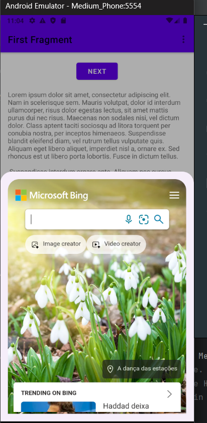

# my-research
[Datadog timers study](https://github.com/WSixx/my-research/blob/main/DOG.md).
 --------------------



---

## Extração de Assembly ARM64 (`scripts/dump_arm64.sh`)

Script Bash ([`dump_arm64.sh`](file:///home/lsg/workspace/my-research/scripts/dump_arm64.sh)) que automatiza a extração do Assembly ARM64. Ele suporta dois modos de operação:

- **Modo Pacote Instalado (`-p`)**: Compila um app ou APK de benchmark já instalado no dispositivo usando `cmd package compile -m speed -f`, localiza o `.odex` via `pm path` e extrai o método com `oatdump`.
- **Modo Arquivo Isolado (`-f`)**: Ideal para quando você está mexendo em uma biblioteca (como a `androidx.collection`) e não quer instalar um app completo. Ele envia um `.dex` ou `.apk` avulso para `/data/local/tmp/`, executa o `dex2oat` diretamente com `--compiler-filter=speed` e extrai o assembly via `oatdump`.

### Exemplos de uso:

```bash
# 1. A partir de um app instalado:
./scripts/dump_arm64.sh -p br.com.seupacote.app -c androidx.collection.CircularIntArray -m indexOf

# 2. A partir de um classes.dex ou APK local sem instalar:
./scripts/dump_arm64.sh -f build/outputs/apk/release/app-release.apk -c androidx.collection.CircularIntArray -m indexOf
```
